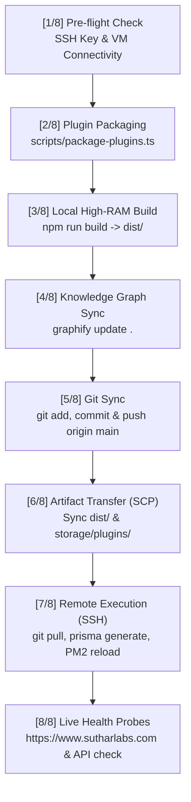

# SutharLabs Production Deployment & Replication Automation Runbook

This guide documents the automated, 1-command deployment pipeline for SutharLabs production infrastructure.

---

## 1. Architectural Architecture & Motivation

### The 1GB RAM Micro-VM Constraint
* **Production Host**: Oracle Cloud Infrastructure (OCI) `VM.Standard.E2.1.Micro` instance running Ubuntu 24.04 LTS (`130.210.37.199`).
* **RAM Available**: **952 MB total memory** + 2 GB swapfile.
* **The Problem**: Running `npm run build` (`vite build` + `esbuild`) directly on the VM causes Node.js V8 memory exhaustion:
  ```text
  <--- Last few GCs --->
  FATAL ERROR: Reached heap limit Allocation failed - JavaScript heap out of memory
  ```
* **The Solution**: 
  1. Frontend assets (`dist/`) and server bundles (`dist/server.cjs`) are built on the local development machine where CPU and memory are abundant.
  2. Workspace plugins are encrypted (AES-256-GCM) and packaged into `storage/plugins/` with SHA-256 integrity checksums synced to Neon PostgreSQL.
  3. Pre-compiled artifacts and encrypted plugin archives are transferred directly to the VM via `scp`.
  4. Remote VM executes git pull, Prisma client generation, and a zero-downtime PM2 reload (`pm2 restart sutharlabs-backend --update-env`).

---

## 2. Reusable Deployment Commands

All steps are consolidated into single, automated commands with automated health verification:

### Method A: Cross-Platform Node Command (Recommended)
From the repository root on any OS:

```bash
# Full build, package, sync, remote reload, and health check
npm run deploy

# Fast deploy (skips local build if dist/ is already compiled)
npm run deploy:quick

# Deploy with custom git commit message
npx tsx scripts/deploy-production.ts --commit="feat: New feature update"
```

### Method B: PowerShell Native Script (Windows Developers)
```powershell
# Standard deployment
.\scripts\deploy-production.ps1

# Quick deploy skipping local build
.\scripts\deploy-production.ps1 -SkipBuild

# Custom commit message
.\scripts\deploy-production.ps1 -CommitMessage "feat: Upgrade telemetry dashboard"
```

---

## 3. The 8-Stage Automated Pipeline

Whenever you run `npm run deploy` or `deploy-production.ps1`, the pipeline executes the following 8 stages automatically:



1. **Pre-flight Check**: Validates the SSH key (`D:\Code\SutharLabs\OracleFreeTier\ssh-key-2026-11-03.key`) and verifies VM connectivity with a fast uptime probe.
2. **Plugin Packaging**: Runs `scripts/package-plugins.ts` to compress in-tree plugins (`ResumeStudio`, `SovereignTools`, `DocNexus`, `ImageStudio`, `SpeechStudio`, `Accounting`, `FlowDesigner`, `StockTracker`), encrypt them with AES-256-GCM, generate SHA-256 hashes, and sync metadata into the remote Neon PostgreSQL database.
3. **Local Production Build**: Runs `npm run build` on host RAM, generating minified, tree-shaken client chunks and Node.js backend bundle in `dist/`.
4. **Knowledge Graph Update**: Runs `graphify update .` to keep the codebase AST knowledge graph synchronized.
5. **Git Synchronization**: Detects modified files, creates an automated timestamped commit (if uncommitted), and pushes to `origin/main`.
6. **Artifact Transfer**: Uploads `dist/*` and `storage/plugins/*` directly to `/home/ubuntu/website/` on VM 3 via `scp`.
7. **Remote Server Reload**: Over SSH, stashes local runtime logs, pulls latest git tree, regenerates Prisma client, and executes `pm2 restart sutharlabs-backend --update-env`.
8. **Live Health Probe**: Probes `https://www.sutharlabs.com/` and `https://www.sutharlabs.com/api/workspace-plugins` to verify the deployment is live and serving traffic with status `200 OK`.

---

## 4. On-VM Direct Maintenance (`scripts/deploy.sh`)

If you are SSH'd directly into VM 3 and need to reload the service without transferring from a host:

```bash
ssh -i "D:\Code\SutharLabs\OracleFreeTier\ssh-key-2026-11-03.key" ubuntu@130.210.37.199

# Run the memory-safe on-VM script
cd /home/ubuntu/website
bash scripts/deploy.sh
```

> [!NOTE]
> `scripts/deploy.sh` automatically detects if `dist/server.cjs` is already present. If present, it skips the heavy client build to prevent exhausting the VM's 1GB RAM. To force an in-place build on the VM with constrained memory, pass `bash scripts/deploy.sh --force-build`.

---

## 5. Rollback & Troubleshooting

### Check Live Server Logs
```bash
ssh -i "D:\Code\SutharLabs\OracleFreeTier\ssh-key-2026-11-03.key" ubuntu@130.210.37.199 "pm2 logs sutharlabs-backend --lines 50"
```

### Restart Backend Manually
```bash
ssh -i "D:\Code\SutharLabs\OracleFreeTier\ssh-key-2026-11-03.key" ubuntu@130.210.37.199 "pm2 restart sutharlabs-backend"
```

### Rollback to Previous Git Commit
```bash
git checkout <previous-commit-hash>
npm run deploy
```

