# SutharLabs Comprehensive System Updates & Changelog

**Release Date**: November 2026  
**Target Environments**: Production VM 3 (`130.210.37.199`), Local Workspaces  
**Domain**: [https://www.sutharlabs.com](https://www.sutharlabs.com)

---

## 1. Executive Summary of Updates

This milestone establishes the official **SutharLabs visual identity**, extracts **Resume Studio** into an enterprise standalone workspace plugin with a **universal multi-input ingestion engine**, introduces the **App Icon & Favicon Studio**, cleans navigation menus across all public and workspace surfaces, and provides an **automated 8-stage zero-downtime deployment pipeline**.

---

## 2. Branding & Asset Generation Engine

### Official 3D Metallic S Emblem Integration
* Replaced temporary SVG placeholders and legacy outline renders across the platform with the official custom 3D metallic blue "S" emblem with native alpha transparency:
  * [`public/favicon.ico`](file:///d:/Code/SutharLabs/website/public/favicon.ico): Multi-resolution container (16x16, 32x32, 48x48, 64x64) with edge contrast enhancement for browser tabs.
  * [`public/favicon-16x16.png`](file:///d:/Code/SutharLabs/website/public/favicon-16x16.png) & [`public/favicon-32x32.png`](file:///d:/Code/SutharLabs/website/public/favicon-32x32.png): High-DPI transparent PNG favicons.
  * [`public/apple-touch-icon.png`](file:///d:/Code/SutharLabs/website/public/apple-touch-icon.png): 180x180 px iOS icon with alpha preservation and 4.5% breathing room.
  * [`public/android-chrome-192x192.png`](file:///d:/Code/SutharLabs/website/public/android-chrome-192x192.png) & `512x512.png`: PWA manifest compliance.
  * [`public/sutharlabs-logo.png`](file:///d:/Code/SutharLabs/website/public/sutharlabs-logo.png) & [`src/assets/sutharlabs-logo.png`](file:///d:/Code/SutharLabs/website/src/assets/sutharlabs-logo.png): High-resolution 1024x1024 transparent master brand emblem.
  * [`public/sutharlabs-logo-sm.png`](file:///d:/Code/SutharLabs/website/public/sutharlabs-logo-sm.png): 256x256 transparent emblem for razor-sharp 8x retina scaling in navbar and mobile drawer headers.
* Fully connected and responsive in [`index.html`](file:///d:/Code/SutharLabs/website/index.html), [`LandingPage.tsx`](file:///d:/Code/SutharLabs/website/src/components/LandingPage.tsx), [`PublicToolsHubView.tsx`](file:///d:/Code/SutharLabs/website/src/components/PublicToolsHubView.tsx), [`AuthPage.tsx`](file:///d:/Code/SutharLabs/website/src/components/AuthPage.tsx), and [`App.tsx`](file:///d:/Code/SutharLabs/website/src/App.tsx).

---

## 3. App Icon & Favicon Studio

### Client-Side PWA & Store Asset Generator
* **Component**: [`AppIconGeneratorTool.tsx`](file:///d:/Code/SutharLabs/website/src/plugins/DocNexus/components/tools/AppIconGeneratorTool.tsx)
* **Route**: `/tools/app-icon-generator`
* **Features**:
  * Drop any source image (PNG, JPG, SVG, WebP).
  * In-browser HTML5 Canvas resampling with high-quality bicubic smoothing.
  * Generates 16 standard resolutions:
    * Browser Favicons: `16x16`, `32x32`, `48x48`, multi-res `.ico`.
    * Apple Touch Icons: `120x120`, `152x152`, `167x167`, `180x180`.
    * Android PWA Manifest: `192x192`, `512x512` (standard & maskable).
    * Social Media Cards: OpenGraph `1200x630`, Twitter Card `1200x600`.
    * Desktop & App Stores: Windows Tile `150x150`, macOS `1024x1024`.
  * Generates ready-to-paste `<head>` HTML code snippets and a valid `site.webmanifest` JSON file.
  * 1-click **Download All Assets (.zip)** packaged in RAM with `JSZip`.

---

## 4. Standalone Resume Studio Plugin (`wp_resume_studio`)

### Decoupled Native Architecture
* **Plugin Directory**: [`src/plugins/ResumeStudio/`](file:///d:/Code/SutharLabs/website/src/plugins/ResumeStudio/)
* **Plugin ID**: `wp_resume_studio`
* **Workspace Route**: `/workspace/resume`
* Decoupled from `PdfToolsStudio` / `Tools Studio` to establish dedicated career modeling capabilities while keeping Tools Studio focused on document and developer utilities.

### Comprehensive 6-Mode Multi-Input Engine
Rather than only offering diverse exports, Resume Studio provides 6 distinct, first-class input variants:

```mermaid
flowchart LR
    subgraph Inputs["Multi-Format Input Variants"]
        I1["1. Visual Form GUI<br/>Granular bullets & cards"]
        I2["2. File Ingestion Dropzone<br/>DOCX, PDF, LaTeX, MD, TXT, JSON"]
        I3["3. Raw Text Scratchpad<br/>Heuristic regex NLP extraction"]
        I4["4. Direct LaTeX (.tex)<br/>Bidirectional live code editor"]
        I5["5. Direct JSON Schema<br/>jsonresume.org standard editor"]
        I6["6. Career Profile Presets<br/>Suresh Kumar, Piyush Rai, Architects"]
    end
    
    subgraph Engine["Resume Studio In-Memory Core"]
        R["Normalized Resume Model<br/>100% Client-Side WASM"]
    end
    
    subgraph Outputs["Vector Export Suite"]
        O1["Word (.docx OpenXML)"]
        O2["PDF Vector Print"]
        O3["LaTeX (.tex)"]
        O4["ATS Plain Text (.txt)"]
        O5["JSON Schema (.json)"]
    end

    Inputs --> Engine
    Engine --> Outputs
```

1. **Visual Form GUI**: Multi-tab form for Basics & Contact, Work Experience positions with add/remove/reorder bullet highlights, Skills categories, Education degrees, and Projects.
2. **Universal File Ingestion Dropzone**:
   * **Microsoft Word (.docx)**: Decompressed in-browser with `JSZip`. Parses `word/document.xml` paragraphs (`w:p`) and textboxes (`w:txbxContent`). Extracts name, email, phone, location, links, bullet points, skills, and sections.
   * **PDF (.pdf)**: Extracted page by page via `pdfjsLib`. Intelligently segments header, contact info, experience entries, and bullet points.
   * **LaTeX (.tex)**: Parses LaTeX commands (`\section{...}`, `\textbf{...}`, `\textit{...}`, `\item`), stripping formatting while capturing structure.
   * **Markdown / Plain Text (.md, .txt)**: Parses Markdown headers (`#`, `##`), bullet lists (`-`, `*`), and contact patterns.
   * **JSON Resume (.json)**: Directly imports standard `jsonresume.org` or custom schemas.
3. **Smart Text Scratchpad & LinkedIn Parser**: Multi-line scratchpad allowing users to paste raw unstructured text. An automated heuristic parser runs regex extraction for contact info and segment identification.
4. **Direct LaTeX (.tex) Source Editor**: Bidirectional code editor allowing users to directly type or edit compile-ready LaTeX markup and apply it back to the structured resume model.
5. **Direct JSON Resume Schema Editor**: Bidirectional code editor for standard JSON schema with live syntax validation and formatting.
6. **Career Profile Presets**: 1-click loaders with real data:
   * **Suresh Kumar Profile**: Senior Consultant & Systems Architect at Capgemini Engineering, Telecom & VoIP, Linux Kernel, MCP, SIP, RTP (derived from `D:\Code\ResumeBuilder\inputs\suresh_resume_input.tex`).
   * **Piyush Rai Profile**: Telecom Technology Analyst / VoIP Gateway (derived from `D:\Code\ResumeBuilder\inputs\Piyush_Rai_resume-1.docx`).
   * **Cloud & Full-Stack Architect Profile**: React, Node.js, Go, TypeScript, Docker, Kubernetes, AWS.
   * **AI Systems & MCP Engineer Profile**: Python, FastMCP, Model Context Protocol, Multi-agent LLM systems.
   * **Clean Blank Slate**: Empty canvas.

### 4-Format Vector Export Suite
* **Microsoft Word (.docx)**: Generated on-the-fly using `JSZip` producing genuine OpenXML packages with clean typography, borders, and margins.
* **PDF Vector Print**: Direct high-dpi vector browser print dialog.
* **LaTeX (.tex)**: Full compile-ready `.tex` document formatted with `titlesec`, `enumitem`, `xcolor`.
* **ATS Plain Text (.txt)**: Clean plain text with standard dividers.
* **JSON Resume (.json)**: Full structured export compatible with `jsonresume.org`.

---

## 5. Menu & Navigation Decluttering

* **Removed "New" Badges**: Removed the promotional `New` badge next to the Tools link on `LandingPage.tsx`.
* **Removed Tool Count Clutter**: Removed count badges (`19 Tools`) from `PublicToolsHubView.tsx` floating navbar and mobile drawers.
* **Cleaner Category Switcher**: Removed count parentheticals (`All Tools`, `Document & PDF`, `Developer & Misc`) in `PdfToolsStudio.tsx` to maintain a calm, professional aesthetic complying with `.agents/rules/ui-styling-and-icons.md`.

---

## 6. Multilingual OCR Enhancements

* **Camera Capture Integration**: Added live camera capture options alongside standard file upload for receipts and business cards.
* **Indian GST Accounting Integration**: OCR extracts invoice numbers, vendor names, line items, and GST tax breakdowns into editable accounting forms before persisting.
* **Single Source of Truth Theme Consistency**: Strictly resolved `isLight` themes without mixing conflicting Tailwind `dark:...` classes.

---

## 7. Reusable Automated Deployment Suite

* **Automation Scripts**:
  * [`scripts/deploy-production.ts`](file:///d:/Code/SutharLabs/website/scripts/deploy-production.ts): Universal Node/TS deployment script.
  * [`scripts/deploy-production.ps1`](file:///d:/Code/SutharLabs/website/scripts/deploy-production.ps1): Native Windows PowerShell runner.
  * [`scripts/deploy.sh`](file:///d:/Code/SutharLabs/website/scripts/deploy.sh): Memory-safe on-VM execution script.
* **NPM Shortcuts**:
  * `npm run deploy`: Full 8-stage pipeline (preflight, package plugins, build `dist/`, sync graph, git push, SCP sync, remote PM2 reload, health check).
  * `npm run deploy:quick`: Fast sync and reload skipping local rebuild.
* **Documentation**: Detailed in [`docs/AUTOMATED_DEPLOYMENT_PROCEDURE.md`](file:///d:/Code/SutharLabs/website/docs/AUTOMATED_DEPLOYMENT_PROCEDURE.md).

---

## 8. Sovereign Storage Vault Chunked Streaming Upload Protocol

* **Diagnosis of 25MB Upload Failure**:
  * `https://www.sutharlabs.com` edge routing through Vercel enforces a strict 4.5 MB request body ceiling on all serverless function calls.
  * When uploading files > 4.5 MB in a single multipart HTTP POST, Vercel edge returned plaintext HTTP 413 `Request Entity Too Large`, which caused `JSON.parse` to throw `Unexpected token 'R', "Request En"... is not valid JSON`.
* **Sovereign Chunking Engine**:
  * **Client-side Chunk Slicing**: Files larger than 3 MB are automatically sliced into **3 MB parts** via `file.slice(start, end)`, comfortably beneath Vercel's 4.5 MB threshold.
  * **Sequential Upload with Progress & Retries**: [`src/services/vaultStorageService.ts`](file:///d:/Code/SutharLabs/website/src/services/vaultStorageService.ts) uploads chunks sequentially to `POST /api/vault/upload-chunk` with live 0–100% progress tracking and automatic 3x retries per chunk with exponential backoff.
  * **Server-side Part Assembly**: [`server.ts`](file:///d:/Code/SutharLabs/website/server.ts) persists chunk parts to `data/vault_chunks/` (or `/tmp/vault_chunks` on Vercel), verifies integrity, concatenates parts into the complete binary payload, streams to Oracle VM 1 (`http://137.23.61.191/api/upload`) for permanent encrypted block storage and SHA-256 verification, and cleanly purges temporary files.
  * **Safe Non-JSON Response Handling**: Updated all upload handlers to parse HTTP status codes and plaintext error previews safely without throwing unhandled `JSON.parse` exceptions.

---

## 9. StudioCast Virtual Broadcast Plugin, Hush Studio Engine Fix & Brand Cache Invalidation

* **Speech Studio Routing & Hush Studio Visibility**:
  * **Route Mounting**: Mounted both `/api/speech` and `/api/plugins/speech-studio` in `src/plugins/serverRegistry.ts`, resolving 404 errors during client-side voice and model queries.
  * **Hush Studio Filter**: Added a dedicated `Hush Studio (6)` filter pill in `SpeechStudioView.tsx`, immediately prioritizing the 6 VoxCPM SOTA in-context reference voices (`Aria`, `Jenny`, `Maya`, `Ethan`, `Cole`, `Priya`).
  * **Engine Banner & Recording Shortcut**: Displayed the dedicated *Hush Studio In-Context Acoustic Reference Engine* banner with instant reference audio testing and direct microphone recording launch.
* **Logo & Favicon Client Cache Invalidation**:
  * Injected cache-busting version identifiers (`?v=20261107-matrix`) into `index.html` favicon links and across all React headers and mobile drawer components (`App.tsx`, `LandingPage.tsx`, `AuthPage.tsx`, `PublicToolsHubView.tsx`).
  * Synced `public/sutharlabs-logo-sm.png` to `src/assets/sutharlabs-logo-sm.png`.
* **New Plugin: StudioCast (`wp_studiocast`)**:
  * **WebRTC Video/Audio Calling**: Peer-to-peer mesh connectivity with camera toggle, microphone muting, screen sharing, and live audio VU meter.
  * **Shareable Invite Link**: One-click generation and clipboard copy of podcast room link (`/workspace?plugin=studiocast&room=POD-XXXX`) allowing guests to connect with zero friction.
  * **Live Canvas Video Compositor**: Real-time 1080p stream compositor inspired by OBS Studio and StreamYard supporting 5 fixed virtual presets:
    1. *Side-by-Side (50/50 Split)*
    2. *Studio Grid (2x2)*
    3. *Speaker Spotlight + Picture-in-Picture (PIP)*
    4. *Broadcast Newsroom with Lower-Thirds Banner*
    5. *Cyberpunk Sovereign Minimal*
  * **Multi-Track ISO Recording Engine**: Main user (host) can record both composed virtual program output and isolated raw camera/mic ISO tracks, exporting `.webm` / `.wav` assets for post-production NLE workflows.
  * **Show Notes & Room Chat**: Integrated timestamped chat and question tagging.

