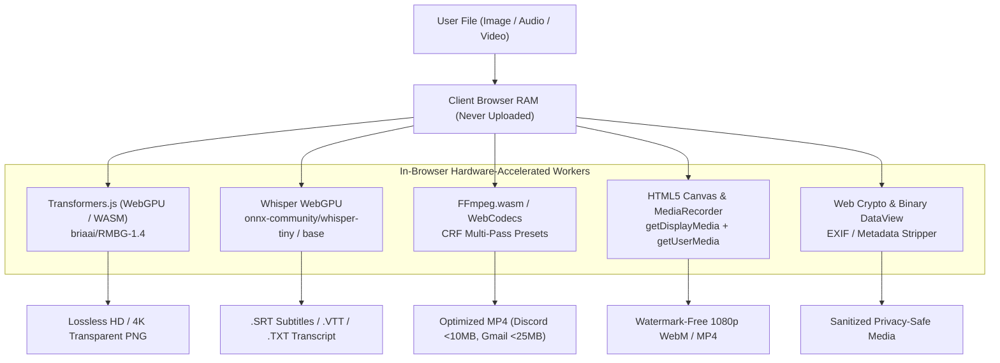
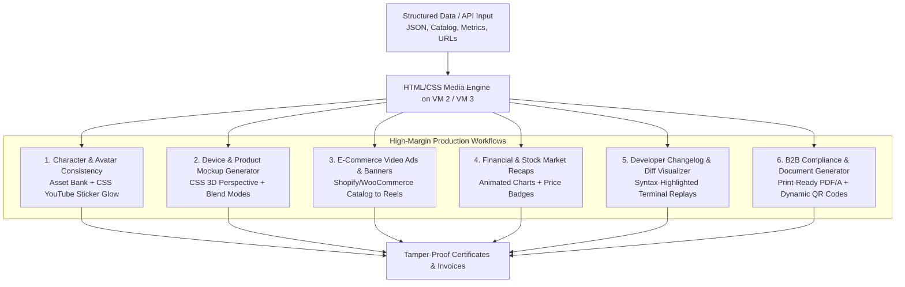
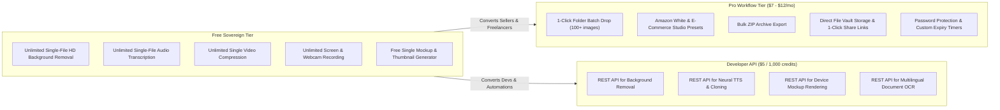

# SutharLabs Creative Automation & High-Demand Free Tools Architecture

**Document Version**: 1.0.0  
**Status**: Approved Architecture & Implementation Blueprint  
**Target Environments**: Client-Side (WebGPU / WASM / Web Workers), Oracle Cloud VM Fleet (VM 1, VM 2, VM 3)  
**Production Domain**: [https://www.sutharlabs.com](https://www.sutharlabs.com)

---

## 1. Executive Summary & Strategic Moat

Digital utility and media creation tools represent one of the highest-intent categories on the internet, capturing hundreds of millions of monthly organic searches. However, the commercial landscape (Canva, Remove.bg, Otter.ai, Loom, Clideo, Kapwing, Smartmockups) is plagued by **aggressive freemium paywall traps**:
* Restricting downloads to **0.25 MP blurry thumbnails** (500x500px).
* Capping audio/video processing to **3 to 5 minutes** or applying massive watermarks.
* Enforcing **$9 to $49/month recurring subscriptions** for basic exports.
* Forcing users to upload private photos, confidential financial data, and sensitive meeting recordings to corporate cloud servers.

SutharLabs solves this by implementing a **dual-engine architecture**:
1. **Client-Side Engine (WebGPU, WebAssembly, WebCodecs, Web Audio API)**: Executes compute-heavy tasks (HD Background Removal, Whisper Audio Transcription, Video Compression, Screen Recording, EXIF Sanitization) **100% inside the user's browser**. SutharLabs incurs **$0.00 in cloud compute costs**, users enjoy **instant zero-latency execution**, and files never leave local RAM.
2. **Headless HTML/CSS-to-Media Engine (2-Core / 12 GB RAM Oracle VM Fleet)**: Executes deterministic graphic design, video rendering (Puppeteer, Satori, Remotion, FFmpeg), character consistency composition, and 3D device/product mockups. By replacing expensive, stochastic $2/hr GPU diffusion clusters with lightweight, pixel-perfect HTML/CSS rendering on standard CPU instances, SutharLabs achieves **85–95% gross margins** on B2B micro-SaaS and automated media generation.

---

## 2. Part I: Client-Side WebGPU / WASM Tool Suite (Zero Server Cost)



### Tool 1: AI Background Remover (HD & 4K Transparent Cutout)
* **Search Volume**: 3.8M – 5.2M searches/month (`remove bg hd`, `transparent png free`, `photo cutout`).
* **Competitive Moat**: Leading competitors (Remove.bg, Photoroom) charge $0.20 to $0.90 per HD credit. SutharLabs provides unlimited full-resolution 4K exports for free.
* **Architecture**:
  * Uses `@huggingface/transformers` running the state-of-the-art `briaai/RMBG-1.4` ONNX segmentation model.
  * WebGPU hardware acceleration with automatic WebAssembly (WASM) fallback.
  * Executes entirely inside a dedicated Web Worker to maintain 60 FPS UI responsiveness.
  * Real-time before/after split slider, interactive background replacement (transparent checkerboard, pure white Amazon `#FFFFFF`, custom studio backdrop colors, subtle drop shadow).

### Tool 2: Audio & Video Transcriber & Subtitle Generator (`.srt` / `.vtt`)
* **Search Volume**: 2.4M – 3.9M searches/month (`transcribe audio to text free`, `auto subtitle generator`).
* **Competitive Moat**: Otter.ai and Descript cap free tiers at 3–5 minutes or force watermarks. SutharLabs transcribes audio locally in RAM without cloud limits.
* **Architecture**:
  * Runs quantized OpenAI Whisper (`onnx-community/whisper-tiny.en` or `whisper-base`) via Transformers.js in Web Worker.
  * Ingests local `.mp3`, `.wav`, `.m4a`, `.mp4`, or WebM files.
  * Generates synchronized timestamped segments with 1-click export to:
    * `.srt` (Adobe Premiere, DaVinci Resolve, Final Cut Pro, YouTube).
    * `.vtt` (HTML5 web players).
    * `.txt` / `.json` (full verbatim transcript with speaker timestamps).

### Tool 3: Smart Video Compressor & Target Size Optimizer
* **Search Volume**: 1.9M – 3.2M searches/month (`compress video under 10mb discord`, `reduce video size free`).
* **Competitive Moat**: Online compressors restrict uploads to 100MB, throttle to 1 file/day, or burn 720p watermarks. SutharLabs processes large videos locally without leaving RAM.
* **Architecture**:
  * In-browser `ffmpeg.wasm` or WebCodecs API with dedicated CRF two-pass bitrate optimization.
  * Presets:
    * **Discord Nitro-Free Target**: `< 10MB` / `< 25MB`.
    * **Gmail / Outlook Email Target**: `< 25MB`.
    * **WhatsApp Mobile Target**: `< 16MB`.
    * **Web Fast-Start Optimizer**: H.264/AAC with faststart MOOV atom relocation.

### Tool 4: Screen & Webcam Studio Recorder (Zero Watermark, Unlimited)
* **Search Volume**: 1.5M – 2.8M searches/month (`screen recorder online no watermark`, `record screen and camera`).
* **Competitive Moat**: Loom limits free accounts to 5 minutes and 25 videos; Clipchamp gates 1080p/60fps behind $12/month.
* **Architecture**:
  * Native browser `navigator.mediaDevices.getDisplayMedia` + `getUserMedia`.
  * Real-time Canvas compositor: floating circular webcam picture-in-picture (PiP) overlay, microphone + system audio mixing, click pulse visualizer.
  * Direct encoding via `MediaRecorder` into high-bitrate WebM / MP4.
  * Zero watermark, unlimited recording duration, instant download or 1-click save to SutharLabs File Vault.

### Tool 5: EXIF & Privacy Metadata Stripper
* **Search Volume**: 450K – 850K searches/month (`remove exif data online`, `strip photo metadata`).
* **Competitive Moat**: Legacy tools are ad-cluttered or force desktop software installations.
* **Architecture**:
  * Binary parsing via `DataView` that parses and strips TIFF/EXIF blocks, GPS coordinate tags, device camera serials, and author metadata from JPEG/PNG/WebP/PDF in milliseconds.

---

## 3. Part II: Headless HTML/CSS-to-Media Engine (Oracle VM Fleet)

### Why HTML/CSS Media Generation Beats GPU Diffusion for Business

| Dimension | Headless HTML/CSS Engine (SutharLabs Oracle VM) | GPU Diffusion Models (Midjourney, FLUX, Sora) |
| :--- | :--- | :--- |
| **Typography & Layout** | **100% Pixel-Perfect**: Native web fonts, kerning, line heights, CSS flexbox/grid, 0% spelling hallucinations. | **Error-Prone**: Stochastically garbles text, struggles with brand fonts and precise alignment. |
| **Execution Latency** | **Instant**: 20ms – 80ms (Satori) or 300ms – 800ms (Headless Chromium). | **Slow**: 2 – 15 seconds per image; 60 – 180 seconds per video clip. |
| **Operating Cost** | **$0.0001 per image / <$0.002 per video**: Runs on standard CPU instances (2 OCPU / 12 GB RAM). | **High**: Requires $1.50 – $3.00/hr cloud GPU clusters (A100/H100) or $0.05/API call. |
| **Brand Compliance** | **100% Deterministic**: Guarantees exact HEX palettes, vector SVG logos, and strict legal disclosures. | **Non-Deterministic**: Unpredictably shifts colors, logos, and proportions across seeds. |
| **Gross Margins** | **85% – 95%** gross margin on SaaS/API subscriptions. | **30% – 50%** gross margin after paying GPU cloud providers. |

---

### Core Applications of the HTML/CSS-to-Media Engine



#### 1. Consistent Character & Avatar Pipeline
* **The Problem**: Pure diffusion models drift facial features, eye spacing, and clothing colors between renders.
* **The Solution**: 
  1. Capture 5–10 consistent portraits (neutral, shocked, pointing, smiling).
  2. Batch-remove backgrounds into transparent PNGs using `briaai/RMBG-1.4`.
  3. The HTML engine positions the character cutout via CSS:
     ```css
     .character-cutout {
       position: absolute;
       right: -20px;
       bottom: 0;
       height: 105%;
       /* Crisp YouTube white sticker glow + depth shadow */
       filter: drop-shadow(0 0 2px #ffffff) 
               drop-shadow(0 0 8px rgba(255, 255, 255, 0.8)) 
               drop-shadow(0 20px 30px rgba(0, 0, 0, 0.7))
               contrast(1.15) saturate(1.2);
       z-index: 10;
     }
     ```
  4. 100% consistent character identity across all thumbnails and video scenes with zero hallucination.

#### 2. Realistic Device & Product Mockup Engine
* **Digital Devices (MacBook, iPhone, iPad, Dual Monitors)**:
  * Uses transparent device bezel PNGs with CSS 3D perspective transforms (`transform: perspective(1000px) rotateY(-15deg)`).
  * Automatically crawls a target website URL or user screenshot and places it behind the screen window with a realistic glass reflection overlay (`mix-blend-mode: screen`).
* **Apparel & Print-on-Demand (T-Shirts, Hoodies, Mugs)**:
  * Base garment photograph + SVG color mask with `mix-blend-mode: multiply` (recolors garment to any HEX code).
  * Injects user design graphic bounded by print area.
  * Overlays grayscale fabric wrinkle/fold map with `mix-blend-mode: overlay`.
* **Packaging & 3D Books**:
  * Assembles 3D book cover bundles (hardcover + spine + tablet) from a single 2D image via CSS 3D rendering.

#### 3. Dynamic E-Commerce Product Video Ads (Catalog-to-Shorts)
* Ingests a Shopify or WooCommerce store catalog via API.
* An HTML/CSS animation template generates 15-second vertical reels (9:16) with Ken Burns pan/zoom, sliding price tags, review star badges, and ambient music stitched via FFmpeg.
* Generates 1,000 video ads daily on standard CPU instances.

#### 4. Automated Financial & Stock Market Daily Recaps
* Ingests live financial data and quant sentiment from SutharLabs StockTracker engine.
* Renders animated interactive charts (Lightweight Charts / Chart.js), highlights top daily gainers/losers, overlays market sentiment meters, and exports automated 30-second recap reels for newsletters and social channels.

#### 5. Developer Changelog & Git Diff Visualizer
* Ingests git commit diffs or terminal sessions.
* Renders animated syntax-highlighted code blocks (Shiki / Prism.js) inside a styled terminal window with typing animations and exports social release video clips.

#### 6. B2B Compliance & Document Automation
* Generates tamper-proof certificates, course completion badges, and financial statements.
* Injects dynamic cryptographic checksums, student IDs, and verification QR codes into responsive HTML/Tailwind templates and renders print-ready, vector-embedded PDF/A documents via Headless Chromium.

---

## 4. Monetization Strategy & Micro-SaaS Tiers



1. **Free Sovereign Tier ($0.00)**:
   * Unlimited single-file HD exports. SutharLabs incurs **zero compute cost** because processing runs entirely in the user's browser.
   * Builds high organic search traffic, user trust, and brand dominance over paywalled competitors.
2. **Pro E-Commerce & Workflow Upgrade ($7 – $12/month or $49/year)**:
   * **1-Click Folder Batching**: Drop 100+ product photos at once; parallel Web Workers process them locally in the background.
   * **Amazon `#FFFFFF` & E-Commerce Presets**: Automatic square padding (2000x2000), studio shadows, and compliance checks.
   * **Bulk ZIP Download**: All processed assets compressed in RAM with `JSZip`.
   * **Vault Cloud Share Links**: 1-click generation of password-protected client delivery links (`sutharlabs.com/share/...`).
3. **Developer API Micro-Credits ($5 per 1,000 requests)**:
   * Headless REST endpoints powered by our multi-tenant concurrency queue (`unifiedInferenceQueue.ts`) and VM fleet.

---

## 5. Commercial Licensing, Legal Compliance & Production Readiness

### Commercial Freedom & Copyright Safety
Unlike generative AI models trained on web-scraped art (which face intense corporate copyright lawsuits and licensing ambiguities), the HTML/CSS-to-media engine is **100% commercially compliant**:
* **Chromium / Playwright / Puppeteer**: Licensed under BSD-3-Clause / Apache 2.0. Permitted in private backend commercial servers without royalty or open-source mandates.
* **FFmpeg CLI Subprocess Architecture**: Executed as a decoupled standalone CLI process (`ffmpeg -y -i ...`) rather than dynamically linked C libraries, strictly adhering to LGPL 2.1+ / GPL terms.
* **Zero Copyright Ambiguity**: Media is assembled strictly using licensed web fonts (Google Fonts / SIL Open Font License), user-provided product photos, and vector SVGs.

### Production Hardening on 2-Core / 12 GB RAM VMs
To ensure continuous, leak-free operation on Oracle Cloud VMs:
1. **Worker Pool & Memory Lifecycle Management**:
   * Headless Chromium processes are recycled after every 100–200 render jobs to prevent V8 DOM heap bloat.
   * Individual renders execute inside isolated browser contexts (`browser.createBrowserContext()`) and close immediately.
2. **Font & Glyph Rendering in Headless Linux**:
   * Pre-install native font bundles on VM 2 / VM 3:
     ```bash
     sudo apt-get install -y fonts-liberation fonts-noto-cjk fonts-roboto fonts-dejavu-core
     ```
   * Embed fonts directly into CSS templates via base64 data URIs or local TTF/WOFF2 paths so renders never stall on external network font CDNs.
3. **Concurrency Throttling & Unified Queue Integration**:
   * Decoupled via `src/services/unifiedInferenceQueue.ts`.
   * Enforces strict concurrency limits on 2-core VMs:
     * Video stitching: `maxConcurrent = 1` (FFmpeg `-preset fast`).
     * Static thumbnails / mockups: `maxConcurrent = 4` (Chromium page instances).

---

## 6. Fleet Allocation & Infrastructure Compatibility

| Server Node | Specs & Role | Workload Allocation |
| :--- | :--- | :--- |
| **Client Browser** | Modern Desktop & Mobile GPU/CPU | **100% of single-file tools**: RMBG-1.4 background removal, Whisper WebGPU transcription, ffmpeg.wasm compression, Canvas screen recording. SutharLabs server CPU load = **0%**. |
| **Oracle VM 1** | 4 OCPU, 24 GB RAM (Ubuntu) | Web app delivery, PostgreSQL multi-tenant database, File Vault storage, user authentication. |
| **Oracle VM 2** | 2 OCPU, 12 GB RAM (Ubuntu ARM64) | Dedicated Neural Node: XTTS-v2 Speech Replication daemon, Ollama LLM, StockTracker Quant Engine. Governed by `unifiedInferenceQueue.ts` mutual exclusion. |
| **Oracle VM 3** | 2 OCPU, 12 GB RAM (Ubuntu ARM64) | Production microservices, Headless Chromium (Puppeteer-core + ARM64 Chromium) for server-side thumbnail and mockup generation, Pro batch rendering. |

---

## 7. Phased Implementation Roadmap

* **Phase 1: HD AI Background Remover Tool**
  * Path: `src/plugins/DocNexus/components/tools/BackgroundRemoverTool.tsx`
  * Add to `TOOLS_LIST` in `PdfToolsStudio.tsx` (`id: 'background-remover'`) and `PublicToolsHubView.tsx`.
  * Deliver 100% client-side WebGPU execution with before/after slider, Amazon white background preset, and lossless PNG download.
* **Phase 2: Audio/Video Transcriber & Subtitles Tool**
  * Path: `src/plugins/DocNexus/components/tools/AudioTranscriberTool.tsx`
  * Deliver in-browser Whisper WebGPU transcription with `.srt`, `.vtt`, and text export.
* **Phase 3: Automated Thumbnail & Mockup Generator Studio**
  * Integrate consistent character cutout overlays and 3D device mockups.
* **Phase 4: Monetization Activation (Pro Batch & Vault Sharing)**
  * Activate multi-file folder batching and direct SutharLabs File Vault 1-click sharing links.
