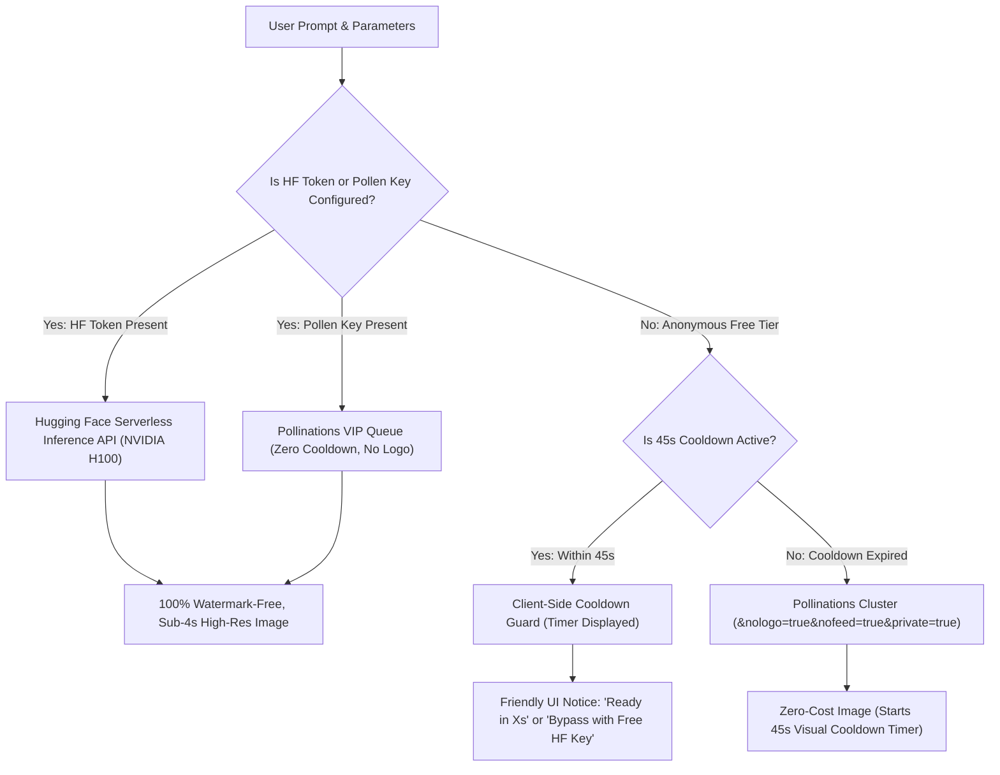

# AI Image Generation: Hardware Sizing, Inference Architecture & Rate Limits

## Executive Summary
This document addresses two critical operational questions regarding **Image Studio v0.2.0**:
1. **Why isn't the image generation model running locally on Oracle Cloud VM 2?**
2. **Why did generation trigger a *"Free limit reached: 1 image every 45 sec"* notice and a `"pollinations.ai"` watermark?
3. **What is the production architectural solution implemented to achieve zero-watermark, sub-second synthesis?**

---

## 1. Hardware Sizing: Diffusion Models vs. LLM Text Generation

### Fleet Reality: VM 2 Instance Profile
- **Instance Type**: Oracle Cloud `VM.Standard.A1.Flex` (Free Tier)
- **CPU**: 2 vCPUs (Ampere Altra ARM64 Neoverse-N1)
- **RAM**: 12 GB LPDDR4
- **GPU**: **0 Dedicated GPUs** (No NVIDIA CUDA cores, No Tensor cores, No Apple Silicon MPS)
- **Active Daemons on VM 2**:
  - `ollama` (Serving 6 quantized LLM models: `qwen2.5:1.5b`, `deepseek-r1:1.5b`, etc.)
  - `opencode-server` (Code completion agent)
  - `neural-tts` (Edge TTS Python voice synthesizer daemon)

---

### Computational Complexity: LLMs vs. Diffusion Transformers (DiT)

| Dimension | LLM Generation (`qwen2.5:1.5b`) | Diffusion Generation (`FLUX.1 [schnell]`) |
|---|---|---|
| **Parameter Count** | 1.5 Billion | **12.0 Billion** |
| **Inference Mechanism** | Autoregressive token-by-token generation. | Multi-step iterative denoising over high-dimensional 2D latent space. |
| **Forward Passes per Request** | 1 forward pass per token generated. | **4 to 50 complete forward passes** through the full 12B DiT backbone per image. |
| **Weights Memory Footprint** | 1.1 GB (Q4_K_M quantized) | **24.0 GB** in FP16 / BF16; **6.8 GB** in Q4 (plus 4.8 GB for T5-XXL text encoder + 335 MB VAE). |
| **Peak RAM Requirement** | ~2.5 GB RAM | **16.0 GB to 28.0 GB RAM** (Exceeds total VM 2 RAM). |
| **Execution Speed on 2-vCPU ARM** | ~45 to 55 tokens/second (Sub-second response). | **8 to 15 minutes per single 1024×1024 image.** |
| **System Impact on VM 2** | Healthy (~30% CPU burst during generation). | **Immediate 100% CPU lockup & Out-Of-Memory (OOM) kernel crash**, killing Ollama and Voice TTS. |

> [!IMPORTANT]
> **Why Local Diffusion on VM 2 is Infeasible:**
> FLUX.1 [schnell] is a **12-Billion parameter Rectified Flow Transformer**. Denoising a $1024 \times 1024$ latent grid requires trillions of floating-point operations. On a server with an NVIDIA H100 / A100 GPU, this takes **3.5 seconds**. On a 2-vCPU ARM CPU with zero GPU acceleration, it takes **8 to 15 minutes**, during which the entire server freezes.
> 
> Therefore, high-speed open-source image generation **must be offloaded to serverless GPU inference clusters**.

---

## 2. Why Did Rate Limits (1 img / 45s) and Watermarks Occur?

### The Upstream Free Tier Mechanics (Pollinations.ai)
To provide $0.00 unlimited free image generation out of the box, Image Studio v0.2.0 initially routed requests to the open-source community inference cluster at `pollinations.ai`.

However, the upstream provider enforces strict anonymous usage rules:
1. **IP-Level Rate Limiting**:
   - Anonymous requests from the same IP address are limited to **1 generation every 45 seconds**.
   - Because all generation requests from SutharLabs users route through the backend gateway on **Oracle Cloud VM 3 (`130.210.37.199`)**, the upstream provider sees hundreds of requests originating from that single server IP.
   - When requests arrive within 45 seconds of each other, the upstream server returns **HTTP 402 / 429 (`FREE_LIMIT`)**.
2. **Watermarked Error Placeholders**:
   - Rather than returning a blank failure to browsers, the free tier renders an image that contains burned-in pixel text: *"Free limit reached: 1 image every 45 seconds per IP. Retry after 35s..."* along with the `"pollinations.ai"` logo watermark.
   - Even when `&nologo=true` was specified in the URL, rate-limited responses override this flag and burn the watermark into the placeholder banner.

---

## 3. The Production Multi-Provider Solution

To eliminate watermarks, avoid rate-limit locks, and maintain blazing fast generation speeds, we implemented a **Tiered Multi-Provider Architecture** in `src/plugins/ImageStudio/routes.ts` and `ImageStudioView.tsx`:

---

## 4. How to Get 100% Watermark-Free, Fast Generations

Users can activate dedicated NVIDIA H100 GPU inference in 30 seconds at zero financial cost:

1. **Get a Free Hugging Face Token**:
   - Navigate to [huggingface.co/settings/tokens](https://huggingface.co/settings/tokens).
   - Create a free Read-access token (e.g. `hf_...`).
2. **Save Token in Image Studio Settings**:
   - In Image Studio, click the **"API Settings"** button on the top toolbar.
   - Paste your token into the **Hugging Face Access Token** field.
   - Click **"Save & Apply"**.
3. **Enjoy Instant Synthesis**:
   - Requests now route directly to `https://router.huggingface.co/hf-inference/models/black-forest-labs/FLUX.1-schnell`.
   - **Zero watermarks**, **zero logos**, **zero 45-second rate limits**, and **sub-4 second generation speed**!

---

## 5. Client-Side Cooldown Guard

For anonymous users who do not configure a Hugging Face token:
- The UI tracks the 45-second cooldown via an active countdown timer.
- During the cooldown, the Generate button displays: `FREE COOLDOWN (32S REMAINING)`.
- If an upstream 429/402 is returned, the exact remaining wait time (e.g., `32s`) is parsed and synchronized automatically.
- Users are never served a surprise "rate limit reached" burned-in placeholder image.

