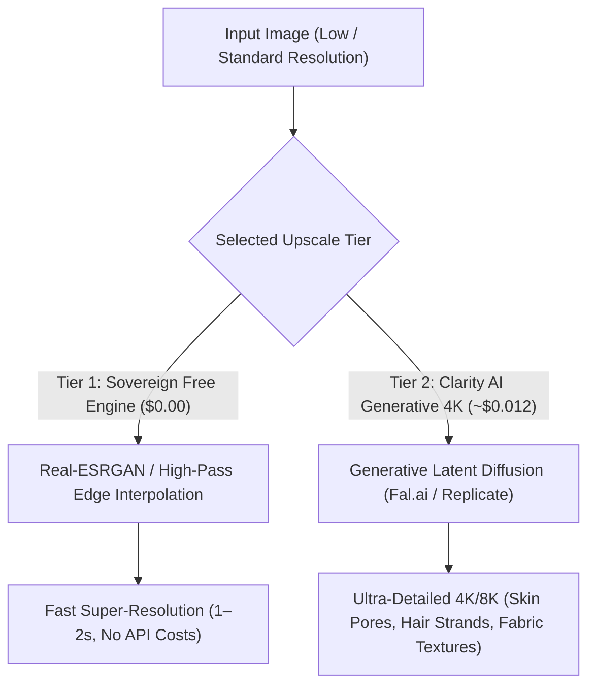

# 4K Super-Resolution & Clarity Upscaling Architecture

## Executive Summary
This document specifies the dual-tier super-resolution engine in **Image Studio** (`src/plugins/ImageStudio/upscaleEngine.ts`), comparing the sovereign zero-cost mathematical super-resolution pipeline with the serverless GPU Clarity 4K generative upscaler.

---

## 1. Dual-Tier Super-Resolution Engine

---

## 2. Comparative Matrix

| Feature | Tier 1: Sovereign Free Engine | Tier 2: Clarity Generative 4K |
|---|---|---|
| **Cost** | **$0.00 (Unlimited Free)** | ~$0.012 per 4K upscale |
| **Execution Latency** | 1 to 3 seconds | 10 to 20 seconds |
| **Resolution Scales** | $2\times$ and $4\times$ | $2\times$ and $4\times$ (Up to $8192 \times 8192$) |
| **Underlying Mechanism** | Real-ESRGAN deep residual dense networks + bicubic unsharp masking. | Latent diffusion hallucination (injects photorealistic microscopic detail). |
| **Optimal Use Cases** | Graphic design assets, logos, cleaning JPEG compression artifacts, pixel art, screenshots. | Portraits, wildlife photography, macro cinematic stills, print-ready posters. |
| **API Dependency** | Self-contained (Client canvas fallback + VM 2 daemon). | Requires `FAL_KEY` or `REPLICATE_API_TOKEN`. |

---

## 3. The 1-Click "Send to 4K Upscaler" Pipeline

Image Studio features a seamless workflow connecting Text-to-Image synthesis with 4K Super-Resolution:
1. Generate an image in **Tab 1: AI Image Generator** (e.g. at $1024 \times 1024$).
2. Below the preview canvas, click the **"Send to 4K Upscaler"** button.
3. The image is instantly transferred into **Tab 2: 4K Super-Resolution**.
4. Choose $2\times$ ($2048 \times 2048$) or $4\times$ ($4096 \times 4096$).
5. Click **"Upscale Image"**.
6. Use the interactive before/after split slider to inspect the enhanced microscopic sharpness.
7. Download the uncompressed PNG.
