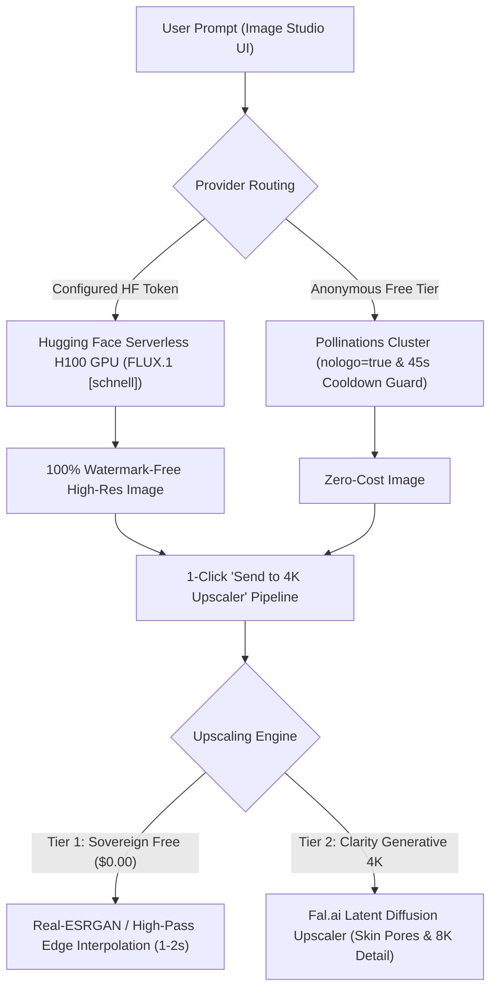

# SutharLabs Image Studio Plugin: Architecture & Engineering Specification

> **Standard:** SutharLabs Sovereign Engine Specification  
> **Plugin Identifier:** `image-studio` (`wp_image_studio`)  
> **Current Version:** `v0.2.0`  
> **Classification:** Generative AI Text-to-Image Synthesis & Neural 4K Super-Resolution

---

## 1. System Overview

Image Studio is a dual-tier visual synthesis and enhancement workbench that combines:
1. **Tab 1: AI Image Generator**: Fast text-to-image synthesis using top open-source models (FLUX.1 [schnell] 12B, SD 3.5 Large 8.1B, SDXL Turbo).
2. **Tab 2: 4K Super-Resolution**: Instant mathematical super-resolution ($0.00) and generative Clarity 4K AI upscaling up to $8192 \times 8192$.

---

## 2. Architectural Pipeline & Model Execution

---

## 3. Supported Open-Source Models
- **FLUX.1 [schnell] (12B)**: Apache 2.0. Sub-5s generation, extraordinary hand anatomy, photorealism, and prompt adherence.
- **FLUX.1 Realism (12B)**: Optimized for skin textures, natural lighting, and cinematic portraiture.
- **Stable Diffusion 3.5 Large (8.1B)**: Distinctive stylized aesthetics and typography.
- **SDXL Turbo (3.5B)**: 1-step adversarial distillation for instant results.

---

## 4. API Endpoints
- `GET /api/plugins/image-studio/models`: Lists foundation models and specifications.
- `GET /api/plugins/image-studio/engines`: Lists upscaling engines (Free vs Clarity 4K).
- `POST /api/plugins/image-studio/generate`: Generates image from prompt with aspect ratio and style presets.
- `POST /api/plugins/image-studio/upscale`: Enhances resolution by $2\times$ or $4\times$.

