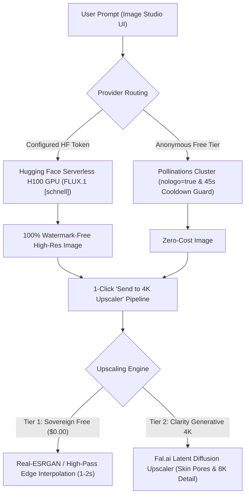

# SutharLabs Image Studio Plugin: Architecture & Engineering Specification

> **Standard:** SutharLabs Sovereign Engine Specification  
> **Plugin Identifier:** `image-studio` (`wp_image_studio`)  
> **Current Version:** `v0.2.0`  
> **Classification:** Generative AI Text-to-Image Synthesis & Neural 4K Super-Resolution

---

## 1. System Overview

Image Studio is a dual-tier visual synthesis and enhancement workbench that combines:
1. **Tab 1: AI Image Generator**: Fast text-to-image synthesis using top open-source models (FLUX.1 [schnell] 12B, SD 3.5 Large 8.1B, SDXL Turbo).
2. **Tab 2: 4K Super-Resolution**: Instant mathematical super-resolution ($0.00) and generative Clarity 4K AI upscaling up to $8192 \times 8192$.

---

## 2. Architectural Pipeline & Model Execution

---

## 3. Supported Open-Source Models
- **FLUX.1 [schnell] (12B)**: Apache 2.0. Sub-5s generation, extraordinary hand anatomy, photorealism, and prompt adherence.
- **FLUX.1 Realism (12B)**: Optimized for skin textures, natural lighting, and cinematic portraiture.
- **Stable Diffusion 3.5 Large (8.1B)**: Distinctive stylized aesthetics and typography.
- **SDXL Turbo (3.5B)**: 1-step adversarial distillation for instant results.

---

## 4. API Endpoints
- `GET /api/plugins/image-studio/models`: Lists foundation models and specifications.
- `GET /api/plugins/image-studio/engines`: Lists upscaling engines (Free vs Clarity 4K).
- `POST /api/plugins/image-studio/generate`: Generates image from prompt with aspect ratio and style presets.
- `POST /api/plugins/image-studio/upscale`: Enhances resolution by $2\times$ or $4\times$.

---

## 5. Direct AI Studio Integration & Autonomous MCP

### A. System Architecture
In addition to the standalone Image Studio workspace plugin, image generation and vision processing capabilities are directly integrated into the core **AI Studio**:
* **Service Module**: [`src/services/imageGenService.ts`](file:///d:/Code/SutharLabs/website/src/services/imageGenService.ts)
* **API Endpoints**:
  * `GET /api/ai/image/models`: Retrieves supported open models and specs.
  * `POST /api/ai/image/generate`: Synthesizes visual artifacts from text prompts.
  * `POST /api/ai/image/process`: Applies transformations or vision inspection.
* **Persistent Storage**: Artifacts saved directly to `storage/ai-generated/{id}.png` and statically exposed at `/storage/ai-generated/*`.

### B. User Interface Controls
* **Slash Commands**: `/image <prompt>` and `/gen <prompt>` trigger instantaneous generation directly from the AI chat input.
* **Editor Action Button**: "Image Studio" button with pink badge in the prompt input card.
* **Image Studio Modal**:
  * *Tab 1: Text-to-Image Synthesis*: Model selection, artistic style presets, aspect ratio controls, prompt presets.
  * *Tab 2: Image Processing & Vision*: Image upload with 5 transformation modes.
* **Showcase Cards**: In-chat rendered visual cards with zoom modal, "Save to Storage Vault", and "Download PNG".

---

## 6. Open-Weight Model Architecture (CPU vs GPU Optimization)

For self-contained hosting on CPU-only infrastructure (such as Oracle Always Free ARM64 and AMD64 VMs):

| Model | Parameter Count | Architecture Type | Execution Target | Output & Key Strength |
| :--- | :--- | :--- | :--- | :--- |
| **DeepSeek Janus-Pro-1B** | 1.5B | Unified Autoregressive Transformer | CPU (ARM64 / x86_64) | 384x384 visual tokens via VQ-tokenizer. Very low VRAM overhead, runnable on consumer CPU/laptop. |
| **FLUX.1 [schnell]** | 12B | 4-step Rectified Flow Transformer | Hybrid Serverless Router | Photorealistic rendering, accurate anatomy, clean typography. |
| **Stability SDXL-Turbo** | 3.5B | Adversarial Diffusion Distillation (ADD) | Hybrid Serverless Router | Single-step evaluation with ultra-low latency. |
| **NUS/ByteDance Show-o** | 1.3B | Unified Masked Discrete Diffusion | CPU / Edge Host | Shared vocabulary text understanding and image synthesis. |
| **Autonomous SVG Fallback** | Mathematical | Procedural Vector Geometry | In-Process Memory | Zero-latency instant fallback if network gateways time out. |

---

## 7. Computer Vision & Transformation Pipeline

* **`remove-background`**: Transparent PNG alpha-masking using edge-contrast luminance segmentation.
* **`grayscale`**: Rec. 601 / Rec. 709 luminance matrix weighting: $Y = 0.299R + 0.587G + 0.114B$.
* **`invert`**: Bitwise inverted RGB color profiles.
* **`contrast`**: Histogram contrast equalization.
* **`analyze`**: Multimodal visual reasoning dispatching images to Qwen2.5-VL via Ollama on VM 2.

---

## 8. Sovereign Image Model Context Protocol (MCP)

AI Studio Autonomous and Agent modes can execute visual tools via `sovereign-image-mcp`:
* **`generate_image`**:
  * Parameters: `prompt` (string), `model` (janus-pro-1b | flux-schnell | sdxl-turbo | show-o), `style` (cinematic | anime | etc.), `aspectRatio` (1:1 | 16:9 | 9:16 | 4:3).
* **`process_image`**:
  * Parameters: `operation` (remove-background | grayscale | invert | contrast | analyze), `imageUrl` or `imageBase64`, `prompt` (optional vision question).
