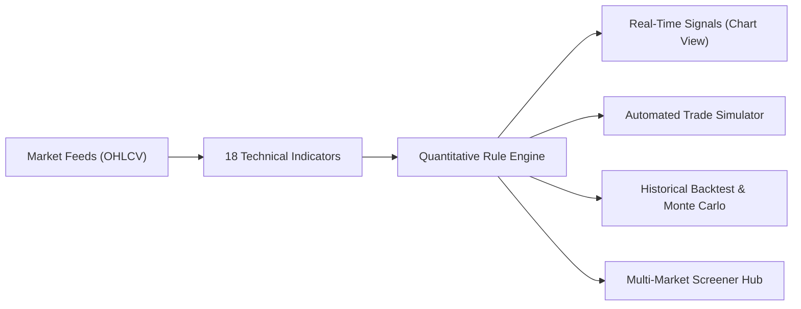

# Quantitative Trading Engine & Algorithmic Strategy Suite

Welcome to the **SutharLabs Quantitative Finance & Algorithmic Strategy Suite** documentation.

---

## Directory Contents

| Document | Description | Primary Code Location |
|---|---|---|
| **[Quantitative Model Architecture](file:///d:/Code/SutharLabs/website/docs/stock-quant/quantitative_model_architecture.md)** | Deep dive into how the Quant Model works, UI locations, 18 technical indicators, rule evaluation, and signal generation. | `src/plugins/StockTracker/` |
| **[Top-Rated Algorithms Backtested](file:///d:/Code/SutharLabs/website/docs/stock-quant/top_rated_quant_algorithms_backtested.md)** | Empirical research, backtest comparative matrix, win rates, and formulas for the 8 core verified presets. | `strategies/presets.ts` |
| **[Algo Review & Architecture Roadmap](file:///d:/Code/SutharLabs/website/docs/stock-quant/algo_review_and_roadmap.md)** | Full architectural specification of the strategy engine, condition trees, and future quantitative roadmap. | `strategies/engine.ts` |
| **[Live Trading & Execution Guide](file:///d:/Code/SutharLabs/website/docs/stock-quant/live_trading_execution_guide.md)** | Brokerage API integration, statutory fees (STT, stamp duty, GST), execution friction, and order routing. | `backtest/friction.ts` |

---

## High-Level Workflow

