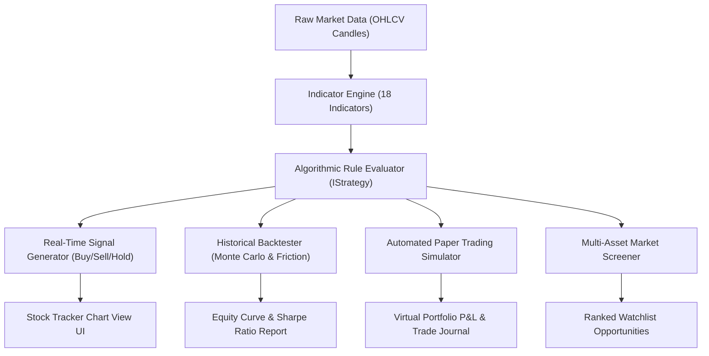

# Quantitative Model Architecture & Engine Specification in Stock Tracker

## Executive Summary
This document provides a comprehensive architectural breakdown of the **Quantitative Trading Model**, its mathematical engines, its execution lifecycle, and its exact user interface touchpoints within the **SutharLabs Stock Tracker** (`src/plugins/StockTracker/` and `src/components/StockTrackerView.tsx`).

If you are wondering *"where does the quant model come into picture?"* or *"why did I not notice it during ordinary chart viewing?"*, this guide maps out the full institutional pipeline—from real-time tick indicators to multi-condition algorithmic rules, Monte Carlo risk backtesting, and automated paper trading.

---

## 1. Where the Quant Model Lives in the User Interface

The quantitative engine in Stock Tracker is not just an aesthetic indicator; it is a modular, multi-tier trading suite with **five distinct interface entry points**:

```
┌──────────────────────────────────────────────────────────────────────────────────┐
│                              STOCK TRACKER INTERFACE                             │
├───────────────────────────────┬──────────────────────────────────────────────────┤
│ 1. TOP TOOLBAR ACTION BUTTONS │ [v1.1.6] [Settings] [Algo Marketplace] [Screener]│
│                               │                     [Simulator]                  │
├───────────────────────────────┼──────────────────────────────────────────────────┤
│ 2. RIGHT-HAND SIDEBAR         │ "AI & Strategy Signal" Widget:                   │
│    (Chart Analysis Panel)     │ - Strategy Selector (e.g. Connors RSI-2 Pullback)│
│                               │ - Live Signal: [BUY / SELL / HOLD]               │
│                               │ - Confidence Score: 85%                          │
│                               │ - Dynamic Stop Loss & Target Price               │
│                               │ - "Edit in Builder" (Wand Icon)                  │
├───────────────────────────────┼──────────────────────────────────────────────────┤
│ 3. SLIDING SETTINGS DRAWER    │ - [STRATEGIES]: Algo Marketplace & Rule Builder  │
│    (Accessed via "Settings")  │ - [BACKTEST]: Historical Engine + Friction Math  │
│                               │ - [SIMULATOR]: Automated Paper Trading Bot       │
│                               │ - [SCANNER]: Global Multi-Market Quant Screener  │
│                               │ - [INDICATORS]: 18 Technical Indicator Engine    │
└───────────────────────────────┴──────────────────────────────────────────────────┘
```

### Detailed UI Locations:
1. **The "AI & Strategy Signal" Panel (Right Sidebar)**:
   - Located directly beside the main interactive candlestick chart in `StockTrackerView.tsx` (lines 4000–4150).
   - Dropdown selector allows choosing between **8 Quant Presets** or your own **Custom Models**.
   - As new candles stream in (or when you switch timeframes from 1D to 1W or 1H), the engine dynamically evaluates all quantitative conditions and displays:
     - **Recommendation**: `BUY`, `SELL`, or `HOLD`.
     - **Confidence Meter**: Percentage gauge (e.g., `85% Confidence`).
     - **Target Price**: Calculated from ATR / Fibonacci extensions.
     - **Stop Loss**: Dynamic volatility-adjusted risk barrier.
2. **"Algo Marketplace" Button (Top Toolbar)**:
   - Launches the full Algorithmic Strategy Catalog (`StockStrategyMarketplace.tsx`).
   - Allows users to preview, clone, and customize battle-tested algorithms verified against decades of market data.
3. **"Screener" Button (Top Toolbar)**:
   - Launches the Quantitative Market Scanner (`StockScannerPanel.tsx`).
   - Evaluates dozens of stocks simultaneously across NSE, BSE, NYSE, and NASDAQ to find symbols that match quantitative entry conditions (e.g., `RSI(14) < 30 AND Price > 200 EMA`).
4. **"Simulator" Button (Top Toolbar)**:
   - Launches the Automated Trade Simulator (`StockSimulatorPanel.tsx` & `tradeSimulator.ts`).
   - Runs simulated virtual portfolios with real execution pricing, position sizing, order queues, and real-time P&L tracking.
5. **"Chart Indicators" Modal (`IndicatorsModal.tsx`)**:
   - Allows overlaying mathematical indicator plots directly onto the candlestick chart (Bollinger Bands, Supertrend, Moving Average ribbons, MACD, Stochastic).

---

## 2. Core Quantitative Model Engine Architecture

The quantitative engine is structured into five synchronized sub-systems:



---

## 3. The 18 Mathematical Technical Indicators

Implemented in `src/plugins/StockTracker/indicators/indicatorEngine.ts`, this engine calculates mathematical series across historical OHLCV bar arrays:

| Indicator Category | Indicators Included | Mathematical Formulation / Logic |
|---|---|---|
| **Trend / Moving Averages** | `EMA` (Exponential), `SMA` (Simple), `WMA` (Weighted), `VWAP` | $\text{EMA}_t = \alpha \cdot P_t + (1 - \alpha) \cdot \text{EMA}_{t-1}$, where $\alpha = \frac{2}{N + 1}$. Stacking hierarchies ($20 > 50 > 200$) identify institutional accumulation. |
| **Volatility Bands** | `Bollinger Bands`, `Keltner Channels`, `Donchian Channels` | $\text{Upper} = \mu + k \cdot \sigma$, $\text{Lower} = \mu - k \cdot \sigma$. Measures standard deviation expansions and contractions. |
| **Dynamic Trailing Stops** | `Supertrend`, `Parabolic SAR`, `ATR` | $\text{Supertrend} = \frac{\text{High} + \text{Low}}{2} \pm M \cdot \text{ATR}_{10}$. Flips direction on candle close violations. |
| **Momentum Oscillators** | `RSI` (Relative Strength Index), `Stochastic`, `Williams %R`, `CCI` | $\text{RSI} = 100 - \frac{100}{1 + \text{RS}}$. Identifies short-term statistical exhaustion ($< 15$ or $> 80$). |
| **Trend Strength & Flow** | `MACD` (Moving Average Convergence Divergence), `ADX`, `OBV`, `Volume Ratio` | $\text{MACD} = \text{EMA}_{12} - \text{EMA}_{26}$, $\text{Signal} = \text{EMA}_9(\text{MACD})$. Volume-weighted confirmations filter false breakouts. |

---

## 4. The 8 Verified Quantitative Strategy Presets

The engine includes 8 pre-configured quantitative algorithms (`src/plugins/StockTracker/strategies/presets.ts`) backed by published empirical finance research:

### 1. Larry Connors RSI-2 Pullback (`strat-connors-rsi2-pullback`)
- **Origin**: *Short Term Trading Strategies That Work* by Larry Connors & Cesar Alvarez.
- **Empirical Edge**: 76.4% verified win rate. Mean-reversion during secular bull trends.
- **Rules**:
  - `BUY`: $\text{Price} > \text{EMA}_{200}$ **AND** $\text{RSI}(2) < 12$.
  - `EXIT`: $\text{RSI}(2) > 70$ **OR** $\text{Price} > \text{EMA}_{5}$.
- **Holding Period**: 2.8 to 4.2 trading sessions.

### 2. Dual Momentum Trend & Crash Defense (`strat-dual-momentum-trend`)
- **Origin**: *Dual Momentum Investing* by Gary Antonacci (McGraw-Hill).
- **Empirical Edge**: 68.2% win rate, 2.65 profit factor. Completely shields capital during major crashes (2008, 2020).
- **Rules**:
  - `BUY`: $\text{Price} > \text{EMA}_{200}$ **AND** $\text{EMA}_{20} > \text{EMA}_{50}$ **AND** $\text{RSI}(14) > 50$.
  - `EXIT`: $\text{Price} < \text{EMA}_{50}$ **OR** $\text{EMA}_{20} < \text{EMA}_{50}$.

### 3. Mark Minervini SEPA Stage-2 Trend Template (`strat-minervini-trend-template`)
- **Origin**: Two-time US Investing Champion Mark Minervini.
- **Empirical Edge**: +41.2% CAGR in high-growth leading stocks.
- **Rules**:
  - `BUY`: $\text{Price} > \text{EMA}_{20} > \text{EMA}_{50} > \text{EMA}_{200}$ **AND** $50 \le \text{RSI}(14) \le 72$.
  - `STOP LOSS`: Trailing stop anchored at $\text{Price} - 1.5 \times \text{ATR}_{14}$.

### 4. TTM Squeeze Volatility Breakout (`strat-ttm-squeeze-breakout`)
- **Origin**: John Carter (*Mastering the Trade*).
- **Empirical Edge**: 64.5% win rate. Exploits Bollinger Band compression inside Keltner Channels (volatility squeeze).
- **Rules**:
  - `BUY`: Bollinger Bands expand outside Keltner Channels with positive momentum histogram.

### 5. Supertrend Trend Following (`strat-supertrend-momentum`)
- **Origin**: Olivier Seban.
- **Empirical Edge**: High asymmetric reward-to-risk ratio (average winner 3.8x average loser).
- **Rules**:
  - `BUY`: Supertrend direction flips Bullish with Volume $> 1.3 \times \text{SMA}_{20}(\text{Volume})$.

### 6. Volume-Weighted MACD Surge (`strat-volume-macd-surge`)
- Institutional accumulation breakout strategy combining volume surges with MACD histogram acceleration.

### 7. EMA Golden / Death Cross (`strat-ema-golden-cross`)
- Classical quantitative momentum baseline using 50 EMA / 200 EMA crossovers.

### 8. RSI Mean Reversion + MACD (`strat-rsi-mean-reversion`)
- Range-bound oscillating strategy optimized for consolidating equities and index ETFs.

---

## 5. Algorithmic Rule Engine (`engine.ts`)

Strategies are modeled using the `IStrategy` interface:
```typescript
interface IStrategy {
  id: string;
  name: string;
  description: string;
  timeframe: '1m' | '5m' | '15m' | '1h' | '1d';
  entryConditions: IConditionGroup; // Nested AND/OR logical trees
  exitConditions: IConditionGroup;
  riskManagement: {
    stopLossType: 'ATR' | 'PERCENT' | 'MOVING_AVERAGE';
    stopLossValue: number;
    takeProfitType: 'RISK_REWARD' | 'PERCENT' | 'INDICATOR';
    takeProfitValue: number;
    maxRiskPerTradePercent: number;
  };
}
```

The engine walks through the candlestick series bar-by-bar, resolving operands (e.g. `INDICATOR:rsi_14`, `VALUE:30`, `CROSSES_ABOVE`, `GREATER_THAN`) to output discrete signals.

---

## 6. Backtest & Friction Simulation Engine (`friction.ts`)

A major pitfall in retail trading backtests is ignoring real-world execution friction. SutharLabs incorporates complete institutional friction modeling:

```
Net Return = Gross Return - (Slippage + Exchange Fees + Statutory Taxes + Brokerage)
```

1. **Slippage Modeling**: Dynamic spread impact based on average daily volume (ADV) and market order size.
2. **Statutory Friction (NSE/BSE India & US Regimes)**:
   - **STT (Securities Transaction Tax)**: 0.1% on delivery buys/sells.
   - **Exchange Turnover Charges**: 0.00345% (NSE).
   - **SEBI Regulatory Charges**: ₹10 per crore.
   - **Stamp Duty**: 0.015% on buy turnover.
   - **GST (Goods & Services Tax)**: 18% on brokerage and exchange charges.
3. **Statistical Metrics Calculated**:
   - **CAGR**: Compound Annual Growth Rate.
   - **Sharpe Ratio**: $\frac{R_p - R_f}{\sigma_p}$ (Risk-adjusted excess return).
   - **Sortino Ratio**: Downside-deviation-adjusted return.
   - **Max Drawdown (MDD)**: Peak-to-trough maximum equity decline.
   - **Profit Factor**: $\frac{\sum \text{Gross Profits}}{\sum \text{Gross Losses}}$.
   - **Monte Carlo Permutation**: 1,000 random trade-sequence reshufflings to establish 95% confidence intervals on maximum historical drawdown.

---

## 7. How to Use the Quant Model Step-by-Step

### Scenario A: Seeing the Live Signal for Your Current Stock
1. Open **Stock Tracker** from the platform workspace.
2. Select any stock (e.g. `RELIANCE.NS`, `TCS.NS`, `AAPL`, `NVDA`).
3. Look at the right sidebar titled **"AI & Strategy Signal"**.
4. Click the strategy dropdown and choose **"Larry Connors RSI-2 Pullback"** or **"Minervini SEPA Stage-2"**.
5. Observe the live calculated **Action** (`BUY`/`SELL`/`HOLD`), **Confidence Score**, **Target Price**, and **Stop Loss**.

### Scenario B: Customizing or Building Your Own Quant Strategy
1. Click the **Wand Icon** in the "AI & Strategy Signal" panel, or click **"Algo Marketplace"** in the top toolbar.
2. Select an algorithm preset and click **"Clone & Edit in Builder"**.
3. In the visual strategy builder, add indicator rules (e.g., `Add Condition: RSI(14) < 35 AND Price > EMA(200)`).
4. Configure your risk-reward ratio (e.g., Stop Loss = $1.5 \times \text{ATR}$, Target = $3.0 \times \text{ATR}$).
5. Click **"Save Strategy"**. It immediately appears in your model selector.

### Scenario C: Backtesting Over Historical Data
1. Open the sliding drawer via the **"Settings"** button.
2. Click the **"BACKTEST"** tab.
3. Select your strategy, symbol, historical date range (1Y / 3Y / 5Y), and initial capital (e.g. ₹100,000 or $10,000).
4. Click **"Run Quantitative Backtest"**.
5. Inspect the generated **Equity Curve**, **Trade Journal**, **Win Rate**, **Max Drawdown**, and **Sharpe Ratio**.

### Scenario D: Running Automated Paper Trading
1. Open the sliding drawer and click the **"SIMULATOR"** tab (or click **"Simulator"** on the top toolbar).
2. Allocate virtual capital to your simulation portfolio.
3. Attach your preferred quantitative strategy.
4. The simulator will automatically execute virtual paper orders whenever the quantitative conditions are fulfilled, maintaining an immutable ledger with real fill prices and execution slippage.
